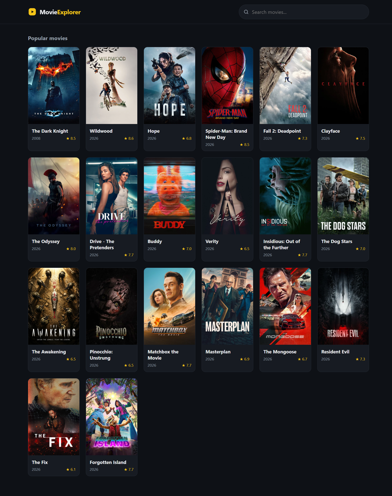

# 🎬 Movie Explorer

A responsive movie browser built with React and TypeScript. It fetches live data from [The Movie Database (TMDB)](https://www.themoviedb.org/) API, shows popular movies on load, and lets you search by title with instant, debounced results.

**🔗 Live demo:** [https://ellie-dhm.github.io/movie-explorer/](https://ellie-dhm.github.io/movie-explorer/)



---

## ✨ Features

- **Live data** from the TMDB API (popular movies by default)
- **Search** by title, with a 400 ms debounce so the API isn't called on every keystroke
- **Loading state**: animated skeleton cards instead of a blank screen
- **Error state**: a friendly message with a **Try again** button when a request fails
- **Empty state**: a clear message when a search returns no results
- **Request cancellation**: outdated requests are aborted with `AbortController`, so a slow response can never overwrite newer results
- **Graceful fallbacks** for movies without a poster or release date
- **Responsive layout** with a sticky header, from phones to large screens
- **Accessible details**: labelled search input, `aria-live` results region, `role="alert"` on errors, and reduced-motion support for animations

## 🛠️ Tech stack

- [React](https://react.dev/) + [TypeScript](https://www.typescriptlang.org/)
- [Vite](https://vite.dev/)
- Plain CSS (no UI library or CSS framework)
- [TMDB API](https://developer.themoviedb.org/docs)
- Deployed on GitHub Pages with GitHub Actions

## 🚀 Getting started

### Prerequisites

- [Node.js](https://nodejs.org/) 18 or newer
- A free TMDB API key (see below)

### 1. Clone and install

```bash
git clone https://github.com/ellie-dhm/movie-explorer.git
cd movie-explorer
npm install
```

### 2. Get a TMDB API key

1. Create a free account at [themoviedb.org](https://www.themoviedb.org/) and verify your email.
2. Go to **Settings → API** and request a key (choose **Developer**).
3. Copy the **API Key (v3 auth)**, the short one, not the long Read Access Token.

### 3. Add your key

Copy the example environment file and paste your key into it:

```bash
cp .env.example .env
```

```env
VITE_TMDB_KEY=your_api_key_here
```

> Restart the dev server after creating or editing `.env`.

### 4. Run it

```bash
npm run dev
```

Then open the URL shown in your terminal.

## 📜 Available scripts

| Command           | Description                              |
| ----------------- | ---------------------------------------- |
| `npm run dev`     | Start the development server             |
| `npm run build`   | Type-check and create a production build |
| `npm run preview` | Preview the production build locally     |

## 📁 Project structure

```
src/
├── api/
│   └── tmdb.ts            # fetch wrapper + API calls
├── components/
│   ├── Header.tsx         # sticky header with logo and search
│   ├── SearchBar.tsx
│   ├── MovieGrid.tsx
│   ├── MovieCard.tsx
│   ├── SkeletonCard.tsx   # loading placeholder
│   ├── ErrorMessage.tsx   # error state with retry
│   └── EmptyState.tsx     # no-results state
├── hooks/
│   ├── useMovies.ts       # data fetching: movies, loading, error, retry
│   └── useDebounce.ts     # delays search updates while typing
├── styles/                # global styles + one CSS file per component
├── types/
│   └── movie.ts           # TypeScript interfaces for API data
├── App.tsx
└── main.tsx
```

## 🧠 How it works

- **`useMovies(query)`** is a custom hook that owns the async logic. It returns `{ movies, loading, error, retry }` and fetches popular movies when the query is empty, or search results otherwise.
- **`useDebounce`** waits until the user stops typing before the query changes, which avoids a request per keystroke.
- **`AbortController`** cancels the previous request whenever the query changes or the component unmounts.
- **`fetch` doesn't throw on HTTP errors** (like 401 or 500), so the API layer checks `res.ok` and throws manually, so that failed requests reach the error state instead of silently looking like "no data".
- The UI renders exactly one of four mutually exclusive states: **loading**, **error**, **empty**, or **results**.

## 🌐 Deployment

The site is deployed to GitHub Pages by a GitHub Actions workflow (`.github/workflows/deploy.yml`) on every push to `main`.

If you fork this project:

1. Change `base` in `vite.config.ts` to match your repository name (e.g. `"/your-repo-name/"`).
2. Add your TMDB key as a repository secret named `VITE_TMDB_KEY` (**Settings → Secrets and variables → Actions**).
3. Set **Settings → Pages → Source** to **GitHub Actions**.

## 🔐 A note on the API key

This is a frontend-only app, so the TMDB key is bundled into the built JavaScript and is visible in the browser's network tab. That's expected for TMDB's free, revocable keys, but it means this approach isn't suitable for secrets that must stay private. For those, you'd proxy requests through a small backend. The `.env` file is git-ignored, so the key is never committed to the repository.

## 🔮 Possible improvements

- Pagination or a "Load more" button (the API returns `total_pages`)
- Genre filter using TMDB's `/discover/movie` endpoint
- Movie details modal or page
- Caching results to avoid refetching repeated searches
- Unit tests for the hooks

## 📄 Attribution

This product uses the TMDB API but is not endorsed or certified by TMDB.

<a href="https://www.themoviedb.org/">
  
</a>
